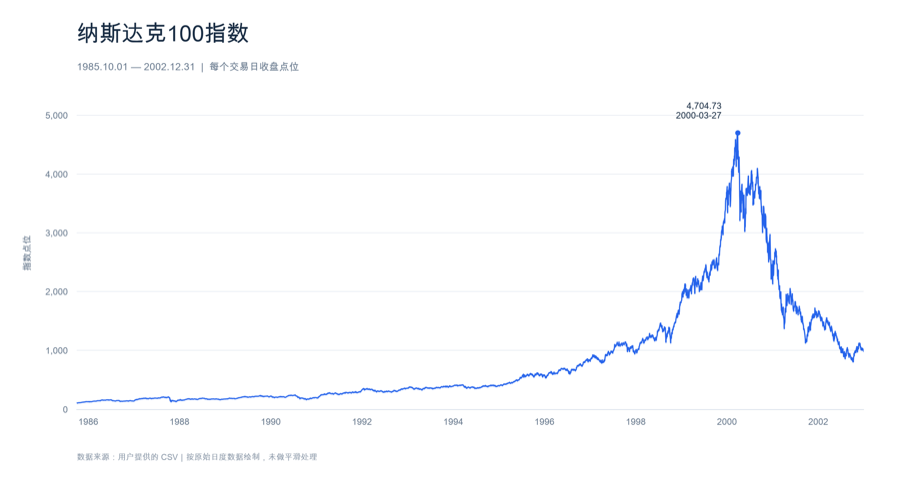
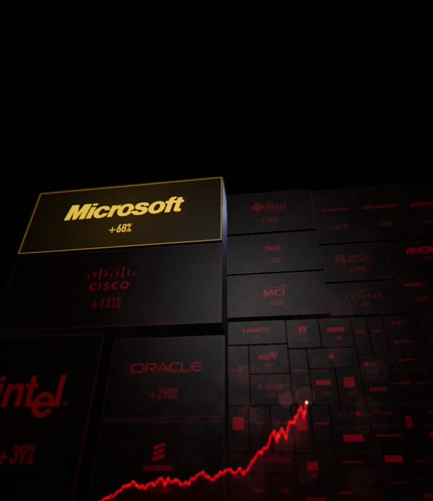

# data-film：让 AI 把数据拍成大片

> **别告诉 AI 画什么，告诉它，你想让人有什么感觉。**

一个给 AI 用的 skill。装上以后，你还是只说一句大白话，比如"帮我画一张折线图"，AI 会先想清楚"这份数据最有戏的是哪一刻、看的人该心里一紧还是喘不过气"，再动手做一版会动的画面。

## 同一份数据，同一句"帮我画一张折线图"

**不装 skill**，AI 交回来的是这个：

**装上 skill**，AI 动手前先打出这几行（Codex 真跑原话，未改动）：

> 这份数据最有戏的是：指数在 2000 年 3 月达到收盘高点 4,704.73，之后跌到 2002 年 10 月的 804.64，跌幅约 82.9%。
> 我想让看的人在高点后的下坠中，心里咯噔一下。
> 画一根折线？我们可以说："镜头跟着线头走，线往下掉，镜头也跟着掉。"

照着表里的说法拍出来，大概是这样（我们成片的截图：镜头跟着线头走 / 一家一块砖挤成墙 / 那天劈一道闪电；部分数据为示意）：

  

## 核心：一张对照表

| 大白话 | 我们可以说 | 观众的感觉 |
|---|---|---|
| 画一根折线 | 镜头跟着线头走，线往下掉，镜头也跟着掉 | 心跳 |
| 列个排名 | 一家一块砖，越大越高，挤成一面墙；镜头从墙脚往上摇 | 压迫 |
| 标出最大跌幅 | 跌得最惨那天劈一道闪电，墙从落点开始由红翻成绿 | 坏事来了 |
| 标出最高点 | 冲到顶的那一刻，镜头停住，四周一下子安静 | 屏住呼吸 |
| 两个东西比大小 | 并排站着，小的那个站在大的脚边，抬头看 | 差距有多大，不用读数 |
| 两条线谁超过谁 | 两个线头赛跑，反超那一刻镜头切到并排的侧面 | 不服、追上了 |
| 占比 / 饼图 | 一整块东西被切走一块，切下来那块掉下去 | 失去了多少 |
| 增长了好多倍 | 从一粒米开始，镜头一路往后退，退到看不见起点 | 不敢相信 |
| 很多年的数据 | 年份像路边的路牌一块块往后飞 | 时间很长、走了很远 |
| 一直平稳突然出事 | 前面拍得很慢很静，出事那一下画面一抖、声音停 | 意外 |

不装 skill 也能用：跟 AI 说话时，把左边那列换成中间那列就行。

## 怎么装

skill 就是 [`data-film/SKILL.md`](data-film/SKILL.md) 这一个文件。

- **Claude Code**：把 `data-film` 整个文件夹放进 `~/.claude/skills/`（只想在某个项目里用，就放进项目的 `.claude/skills/`）。
- **Codex**：把 `data-film` 文件夹放进项目的 `.agents/skills/`。
- **其他 AI（网页版聊天也行）**：打开 `SKILL.md`，全文复制，在对话一开头发给它，再发你的数据和要求。

装好后照常说话就行，比如："这是纳斯达克 100 指数的数据，帮我画一张折线图"。

## 它会怎么做

1. 先找数据里最有戏的一刻，说出想让观众有什么感觉，把你的话翻译成"大白话？我们可以说：……"。
2. 写一张短分镜：每 1～2 秒有新东西，一个主色加一个强调色。
3. 先做最有戏的 10 秒（一个打开就自动播放的网页），你点头了再往前后接。

## 来源

做抖音视频时整理出来的，对照表里每一句都在片子里真拍过。欢迎拿去用、改、补充。

## License

MIT
